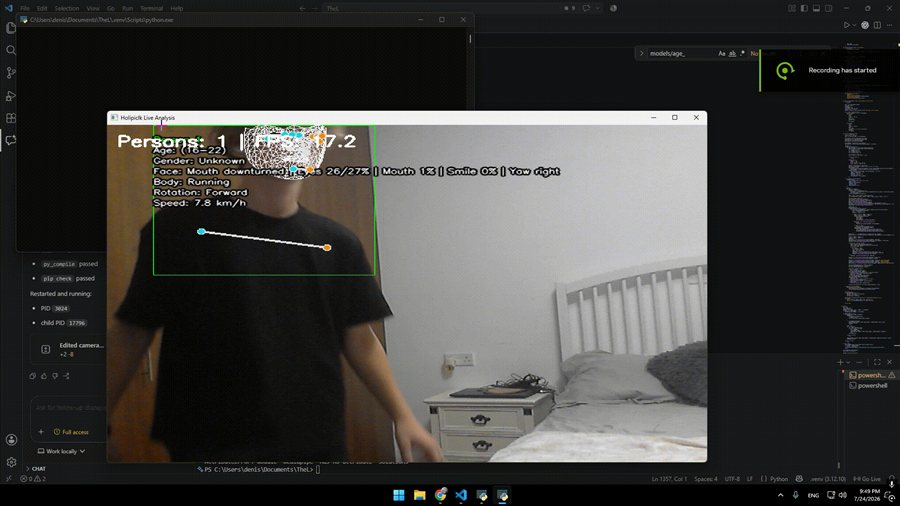

  

<h1 align="center">Hi, I'm Denis 👋</h1>

## About Me

- 📍 **Location:** Paphos, Cyprus
- 🎂 **Age: 15**
- 🏫 **School:** International School of Paphos
- 💻 **Focus:** Web Development & Software Development

### Languages & Frameworks

`HTML` · `CSS` · `JavaScript` · `React` · `Vite` · `Python`

### Tools

`Codex` · `Claude` · `Antigravity`

### Other Experience

I used to make games with **Unreal Engine 5** and **Unity**.

  

## Let's Build Together

I'm always happy to meet people to code—and vibe-code—with. I'm friendly, and I'd genuinely love to make friends who want to build things together so we can learn, create, and develop side by side.

## Socials

- **Reddit:** [u/peps1z](https://www.reddit.com/user/peps1z/)
- **SoundCloud:** [peps1z](https://soundcloud.com/peps1z)
- **TikTok:** [@always_busy03](https://www.tiktok.com/@always_busy03)
- **Instagram:** [@fdbusy03](https://www.instagram.com/fdbusy03/)
- **Telegram channel:** [Dentisooo](https://t.me/Dentisooo)

  

## Featured Projects

<table>
  <tr>
    <td width="50%" valign="top">
      
      <h3><a href="https://github.com/girman-denis2011/TheL">TheL</a></h3>
      
A local Python webcam analyzer using OpenCV and MediaPipe for face, body, hand, and movement cues.

      
<code>Python</code> <code>OpenCV</code> <code>MediaPipe</code>

    </td>
    <td width="50%" valign="top">
      
      <h3><a href="https://github.com/girman-denis2011/Gym-Template">Gym Template</a></h3>
      
A gym booking website with a public landing page, booking flow, PIN-protected admin panel, and Telegram bot.

      
<code>JavaScript</code> <code>Node.js</code> <code>Python</code>

    </td>
  </tr>
  <tr>
    <td width="50%" valign="top">
      
      <h3><a href="https://github.com/girman-denis2011/LFEASY">LFEASY</a></h3>
      
A full-stack fintech-style app with authentication, wallets, transactions, exchange features, cards, and KYC flows.

      
<code>React</code> <code>Vite</code> <code>TypeScript</code> <code>Express</code> <code>Prisma</code>

    </td>
    <td width="50%" valign="top">
      
      <h3><a href="https://github.com/girman-denis2011/coaching">3×3 Basketball Coaching App</a></h3>
      
An interactive basketball court for planning plays with draggable players and a movable ball.

      
<code>HTML</code> <code>CSS</code> <code>JavaScript</code>

    </td>
  </tr>
</table>
